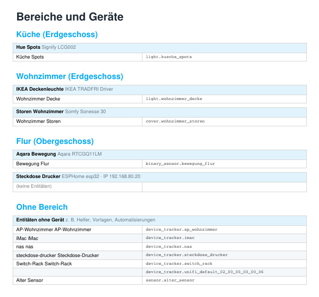
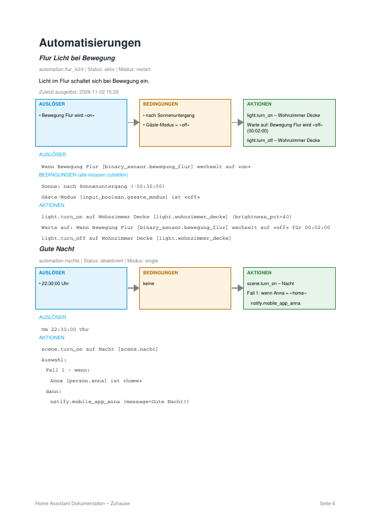
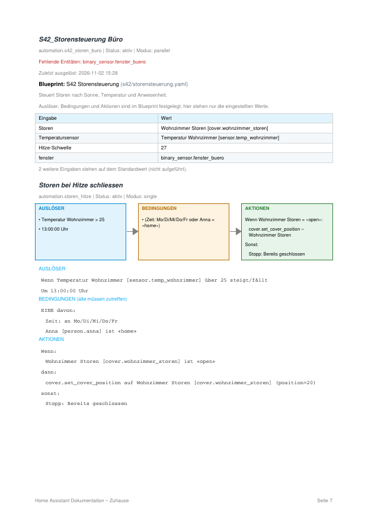

# HA Doku – Home Assistant Add-on

Erstellt per Knopfdruck (oder automatisch jeden Monat) ein **PDF** deiner Home-Assistant-Installation:
Bereiche, Geräte und Entitäten, Integrationen, Netzwerk (UniFi/Fritz!Box), Automatisierungen, Skripte, Szenen, Helfer und Auffälligkeiten.
Alles läuft lokal in deinem Home Assistant, es werden keine Daten nach aussen gesendet.

*Creates a PDF documentation of your Home Assistant setup (areas, devices, automations, scripts, scenes, helpers and issues) – locally, on demand or monthly.*

## Handbuch

* Deutsch: [HANDBUCH.de.md](docs/HANDBUCH.de.md) ([PDF](docs/HANDBUCH.de.pdf))
* English: [MANUAL.en.md](docs/MANUAL.en.md) ([PDF](docs/MANUAL.en.pdf))

## Funktionen

- **Auswahl vor dem Erstellen:** Abschnitte, einzelne Bereiche, Diagnose-Entitäten ausblenden, nur Einträge mit fehlenden Entitäten.
- **Änderungsvergleich (optional):** was ist seit dem letzten Stand neu, entfernt oder geändert?
- **Eigene Bemerkungen** zu Bereichen, Geräten, Entitäten, Automatisierungen u. a. (im PDF, in Excel und im Änderungsvergleich).
- **Excel-Export** mit aufklappbaren Geräten (Entitäten eingeklappt), Netzwerk und Integrationen.
- **Ein Kasten pro Gerät** mit Gerätename, Hersteller/Modell und allen Entitäten (mit Namen).
- **Automatisierungen als Text und als Schema** (Auslöser → Bedingungen → Aktionen), gleichartige Auslöser zusammengefasst.
- **Blueprints:** Name, Beschreibung und nur die vom Standard abweichenden Eingaben.
- **Auffälligkeiten:** nicht verfügbare Entitäten und Verweise auf Entitäten, die es nicht mehr gibt (auch in Blueprint-Eingaben).
- **Monatlicher Bericht** optional, mit Aufbewahrung der letzten N Berichte. Manuell erstellte Dateien lassen sich einzeln löschen.

| Geräte | Automatisierung als Schema | Blueprint |
|---|---|---|
|  |  |  |

*(Beispielbilder mit Demodaten.)*

## Installation

1. In Home Assistant: **Einstellungen › Add-ons › Add-on-Store › ⋮ › Repositories** und diese Adresse hinzufügen:
   `https://github.com/markus321/ha-doc-addon`
2. **HA Doku (PDF)** installieren und starten, «In Seitenleiste anzeigen» aktivieren.
3. In der Seitenleiste **HA Doku** öffnen, Abschnitte wählen und **PDF erstellen**.

Die PDFs liegen in der Freigabe `share` im Ordner `ha_doc`.

Voraussetzung: Home Assistant OS oder Supervised (Add-ons), Architektur amd64 oder aarch64.

## Monatlicher Bericht

Unter **Konfiguration** des Add-ons «Monatlichen Bericht erstellen» einschalten, Tag und Uhrzeit wählen. Der Bericht verwendet die Auswahl, die du in der Oberfläche mit **«Auswahl für Monatsbericht speichern»** festgelegt hast (Abschnitte, Bereiche, Filter). Ohne gespeicherte Auswahl gelten die Schalter in der Konfiguration.
Damit der Bericht wirklich erstellt wird, muss das Add-on laufen: **«Beim Systemstart starten»** einschalten.

## Datenschutz

Das Add-on liest die Konfiguration deines Home Assistant über die interne Schnittstelle (Supervisor) und schreibt PDFs in `share/ha_doc`.
Es sendet nichts ins Internet. Das PDF enthält Namen und IDs deiner Geräte und Entitäten – gib es mit Bedacht weiter.

## Support und Haftung

Ein privates Projekt, bereitgestellt wie es ist (MIT-Lizenz, siehe `LICENSE`). Fehler und Wünsche gerne als [Issue](https://github.com/markus321/ha-doc-addon/issues) melden; bitte keine PDFs oder Protokolle mit persönlichen Daten anhängen. Das Add-on liest nur und verändert deine Home-Assistant-Konfiguration nicht.

## Bekannte Grenzen

- Automatisierungen, die in YAML ohne ID definiert sind, sind über die Schnittstelle nicht lesbar und erscheinen mit Hinweis.
- Vom Blueprint selbst werden Auslöser und Aktionen nicht dargestellt, nur seine Eingaben.
- Der Abschnitt «Netzwerk» funktioniert nur mit einem UniFi-Gateway oder einer Fritz!Box (Integrationen «UniFi Network» bzw. «AVM FRITZ!Box Tools»). Eine Port-Zuordnung der Switches ist nicht enthalten.
- Add-ons und Zigbee-Topologie sind noch nicht enthalten.
