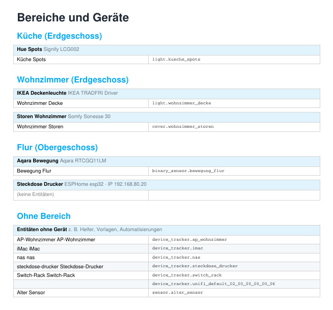
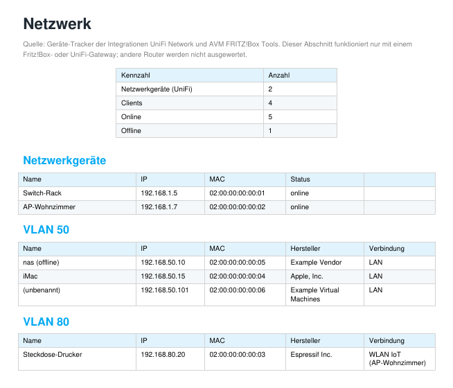
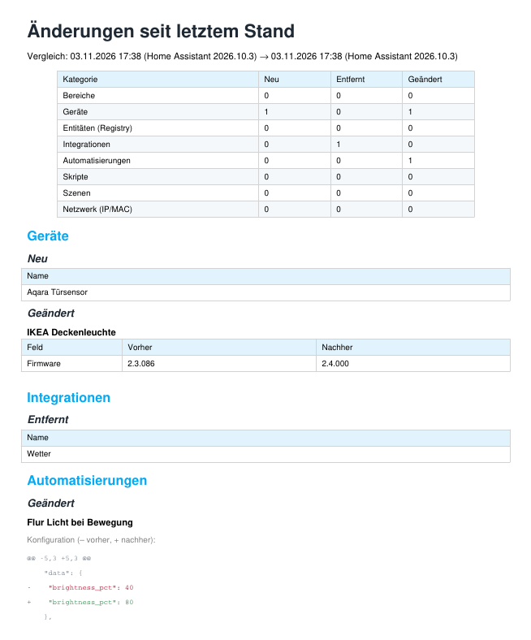
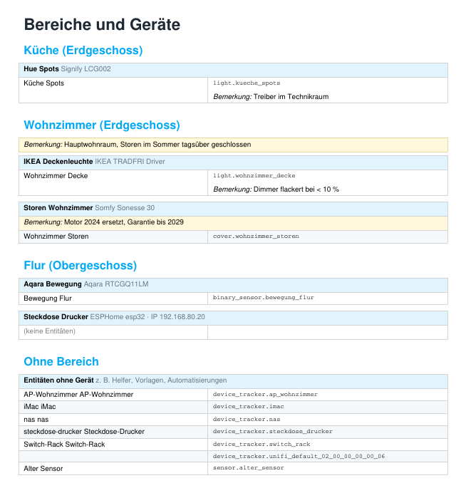

# 1. Was ist layvo Doku?

layvo Doku ist ein Add-on für Home Assistant. Es liest deine Installation aus und erstellt daraus eine übersichtliche **Dokumentation als PDF** und auf Wunsch eine **Excel-Datei**. Das Add-on läuft lokal, liest nur und verändert deine Konfiguration nicht. Es sendet keine Daten ins Internet.

Das PDF enthält je nach Auswahl:

| Abschnitt | Inhalt |
|---|---|
| Übersicht | Kennzahlen (Entitäten, Geräte, Bereiche, Integrationen …) und Entitäten nach Domain |
| Bereiche und Geräte | pro Bereich ein Kasten je Gerät mit Hersteller, Modell, IP (falls bekannt) und allen Entitäten |
| Integrationen | alle eingerichteten Integrationen mit Status und Quelle |
| Netzwerk | IP, MAC, Hersteller, VLAN und WLAN/LAN der Geräte im Heimnetz (nur UniFi oder Fritz!Box, siehe Kapitel 7) |
| Automatisierungen (Text) | Auslöser, Bedingungen und Aktionen in Klartext, Blueprint-Automatisierungen mit ihren Eingaben |
| Automatisierungen (Schema) | Auslöser → Bedingungen → Aktionen als Schema |
| Skripte, Szenen, Helfer | jeweils mit den wichtigsten Angaben |
| Auffälligkeiten | nicht verfügbare Entitäten und Verweise auf Entitäten, die es nicht mehr gibt |
| Eigene Bemerkungen | optional zu Bereichen, Geräten, Entitäten u. a. (Kapitel 9) |
| Änderungen seit letztem Stand | optional: Vergleich mit der letzten gespeicherten Momentaufnahme (Kapitel 8) |

# 2. Voraussetzungen

* Home Assistant OS oder Supervised (Add-ons müssen verfügbar sein).
* Architektur amd64 oder aarch64.
* Für den Abschnitt «Netzwerk»: Integration «UniFi Network» (UniFi-Gateway) oder «AVM FRITZ!Box Tools» (Fritz!Box).

# 3. Installation

1. **Einstellungen › Add-ons › Add-on-Store › ⋮ › Repositories** öffnen und diese Adresse hinzufügen:  
   `https://github.com/markus321/ha-doc-addon`
2. Das Add-on **layvo Doku** installieren.
3. **«Beim Systemstart starten»** und **«In Seitenleiste anzeigen»** einschalten, dann das Add-on starten.
4. In der Seitenleiste **layvo Doku** öffnen.

Updates erscheinen im Add-on-Store: **⋮ › Nach Updates suchen**, danach **Aktualisieren**. Die Suche kann bis zu einer Minute dauern; eine Fehlermeldung wie «Unknown error» ist in dieser Zeit meist nur ein Zeitlimit der Oberfläche. Lade die Seite nach einer Minute neu.

# 4. Bedienung der Oberfläche

Die Oberfläche folgt dem Hell-/Dunkelmodus von Home Assistant.

**Abschnitte.** Hake an, was ins PDF soll. Der Abschnitt «Änderungen seit letztem Stand» ist standardmässig ausgeschaltet.

**Optionen.**

* *Konfigurations- und Diagnose-Entitäten ausblenden* verkürzt die Geräteliste deutlich. Pro Gerät steht dann «+ n Konfigurations-/Diagnose-Entitäten ausgeblendet».
* *Automatisierungen, Skripte, Szenen: nur mit fehlenden Entitäten* zeigt nur Einträge, die auf nicht mehr vorhandene Entitäten verweisen. Das ist praktisch zum Aufräumen.
* *Änderungsvergleich: diesen Stand als neue Referenz speichern* (nur relevant mit dem Abschnitt «Änderungen», Kapitel 8).

**Bereiche.** Unter «Bereiche auswählen» lässt sich die Dokumentation auf einzelne Bereiche beschränken (inklusive «Ohne Bereich»).

**Deckblatt.** Unter **«Deckblatt: Ersteller und Kunde (optional)»** erfasst du Firma (Ersteller) mit Adresse, Telefon, E-Mail und Webseite, den Kunden mit Adresse und Objekt/Projekt sowie Version/Stand und Bearbeiter. Mit **«Angaben auf dem Deckblatt anzeigen»** erscheinen sie auf dem Deckblatt der PDFs, auch im Monatsbericht. Standardmässig ist die Funktion aus. Gespeichert wird in `cover.json` im Ordner `ha_doc` der Freigabe. Das PDF enthält dann Namen und Adressen; für Weitergabe und Datenschutz bist du selbst verantwortlich.

**Logo.** Unter **«Logo im PDF»** wählst du, ob auf dem Deckblatt und in der Fusszeile der PDFs das **layvo-Logo**, **kein Logo** oder ein **eigenes Logo** steht. Für ein eigenes Logo wählst du eine PNG- oder JPG-Datei (höchstens 2 MB) und klickst auf **«Logo speichern»**. Am besten eignet sich ein querformatiges Logo mit transparentem Hintergrund. Die Einstellung liegt im Ordner `branding` der Freigabe und bleibt bei einer Neuinstallation erhalten. Sie gilt auch für den Monatsbericht, nicht für die Excel-Datei.

**Knöpfe.**

| Knopf | Wirkung |
|---|---|
| PDF erstellen | erzeugt das PDF mit der aktuellen Auswahl |
| Excel erstellen | erzeugt die Excel-Datei (Kapitel 6); es gelten die Bereiche und der Diagnose-Filter |
| Bemerkungen erfassen | öffnet die Seite für eigene Bemerkungen (Kapitel 9) |
| Auswahl für Monatsbericht speichern | speichert die aktuelle Auswahl für den automatischen Bericht (Kapitel 5) |

**Dateiliste.** Alle erstellten Dateien stehen unten in der Liste. Ein Klick auf den Namen öffnet das PDF bzw. lädt die Excel-Datei herunter. Mit **Löschen** (mit Rückfrage) entfernst du einzelne Dateien. Die Dateien liegen in der Freigabe `share` im Ordner `ha_doc`, du erreichst sie also auch über Samba oder den Dateieditor.

Während du selbst eine Datei erstellst, aktualisiert sich die Seite automatisch. Bei einem automatischen Bericht lädst du die Seite selbst neu.

# 5. Monatlicher Bericht

Unter **Konfiguration** des Add-ons:

| Option | Bedeutung |
|---|---|
| Monatlichen Bericht erstellen | schaltet die Automatik ein (Standard: aus) |
| Tag im Monat | 1 bis 28 |
| Uhrzeit | Format HH:MM, in der Zeitzone von Home Assistant |
| Anzahl aufbewahrter PDFs | wie viele **automatische** Berichte erhalten bleiben (1 bis 100) |
| Einstellungen der Oberfläche verwenden | Standard: an. Der Bericht nutzt die mit «Auswahl für Monatsbericht speichern» gesicherte Auswahl |
| Abschnitt: … (Schalter) | gelten, wenn nichts gespeichert ist oder die Oberflächen-Einstellungen aus sind |
| Diagnose-Entitäten ausblenden, Nur Einträge mit fehlenden Entitäten, Nur diese Bereiche | Filter, ebenfalls als Ersatz |

**Wichtig:**

* Nach dem Speichern der Konfiguration das Add-on **neu starten**. Es liest die Konfiguration nur beim Start.
* Das Add-on muss laufen (**«Beim Systemstart starten»**). Wurde ein Termin verpasst, holt das Add-on den Bericht beim nächsten Start nach.
* Unter der Dateiliste steht, wann der nächste Bericht erstellt wird und was er enthält.
* Automatische Berichte heissen `ha_monatsbericht_…`, manuell erstellte Dateien `ha_dokumentation_…`. Nur automatische Berichte werden nach «Anzahl aufbewahrter PDFs» aufgeräumt. Manuelle Dateien bleiben, bis du sie löschst.

# 6. Excel-Export

«Excel erstellen» legt eine `.xlsx`-Datei mit drei Blättern an:

* **Geräte:** pro Bereich eine Zeile, darunter die Geräte mit Hersteller/Modell, IP und Anzahl Entitäten. Die **Entitäten sind eingeklappt**. Mit dem **Plus am linken Rand** neben einem Gerät klappst du sie auf, mit dem Minus wieder zu. Die Ebenen-Knöpfe **1** und **2** oben links klappen alles auf einmal zu oder auf. Pro Entität stehen Name, Entität-ID und aktueller Zustand.
* **Netzwerk:** IP, MAC, Hersteller, VLAN, Verbindung und Status mit Filter (nur mit UniFi oder Fritz!Box).
* **Integrationen:** Integration, Domain, Status, Quelle.

Der Monatsbericht erstellt nur das PDF, keine Excel-Datei.

# 7. Netzwerk (nur UniFi und Fritz!Box)

Der Abschnitt «Netzwerk» nutzt die Geräte-Tracker der Integrationen **UniFi Network** und **AVM FRITZ!Box Tools**. **Er funktioniert nur mit einem UniFi-Gateway oder einer Fritz!Box.** Bei anderen Routern bleibt er leer, und das PDF weist darauf hin.

* **Netzwerkgeräte** (Gateway, Switches, Access Points) stehen oben mit IP, MAC und Status.
* **Clients** sind nach VLAN gruppiert, mit IP, MAC, Hersteller und Verbindung (LAN oder WLAN mit SSID und Access Point).
* In der Gerätetabelle steht bei Geräten die **IP**, wenn ihre MAC-Adresse zu einem Tracker passt.

**Einrichtung bei UniFi:** Integration «UniFi Network» hinzufügen (Host, lokaler Benutzer, Passwort; ein Ubiquiti-Cloud-Konto funktioniert nicht). Unter **Konfigurieren** das Verfolgen von Netzwerk-Clients einschalten. Ohne diese Option fehlen die Clients.

Grenzen: Die Zuordnung der Geräte zu Switch-Ports liefert die Integration nicht. Clients ohne Hostnamen erscheinen als «(unbenannt)» mit MAC und Hersteller.

# 8. Änderungsvergleich (optional)

Der Abschnitt **«Änderungen seit letztem Stand (optional)»** ist standardmässig aus. Er ergänzt die Dokumentation um die Frage: *Was hat sich seit dem letzten Mal geändert?*

**So funktioniert es:**

* Das Add-on speichert eine **Momentaufnahme** (JSON) im Ordner `ha_doc/snapshots` der Freigabe `share`. Die letzten 24 bleiben erhalten.
* Das PDF vergleicht den aktuellen Stand mit der letzten Momentaufnahme: neue, entfernte und geänderte Bereiche, Geräte, Entitäten (Registry), Integrationen, Automatisierungen, Skripte, Szenen und Netzwerk-Adressen. Bei Automatisierungen, Skripten und Szenen steht die Änderung der Konfiguration als Vorher/Nachher (rot: entfernt, grün: neu).
* **Automatische Berichte** speichern jedes Mal einen neuen Stand. Der Monatsbericht vergleicht also mit dem Vormonat.
* **Manuelle Berichte** vergleichen nur. Sie verändern die Referenz nur, wenn du **«diesen Stand als neue Referenz speichern»** anhakst. So verschieben Testläufe die Referenz nicht.
* Der **erste** Lauf speichert immer einen Stand und zeigt «Erster gespeicherter Stand». Der Vergleich beginnt beim nächsten Lauf.

**Grenzen:** Der Vergleich zeigt **was** sich geändert hat, aber nicht **wer** es geändert hat; das speichert Home Assistant meist nicht. Zwischen zwei Ständen sieht er nur das Ergebnis, nicht jeden einzelnen Zwischenschritt. Labels und die Bereiche einzelner Entitäten sind noch nicht enthalten. Eigene Bemerkungen (Kapitel 9) werden als Kategorie «Bemerkungen» mitverglichen. Es ist ein Änderungsprotokoll, kein revisionssicherer Audit-Trail: Die Momentaufnahmen sind weder gegen Löschen noch gegen Veränderung geschützt.

# 9. Eigene Bemerkungen

Mit **«Bemerkungen erfassen»** (neben «Excel erstellen») öffnest du eine eigene Seite. Dort kannst du zu deiner Installation eigene Texte erfassen, zum Beispiel «Motor 2024 ersetzt, Garantie bis 2029» oder «Dimmer flackert».

**Bedienung:**

* Die Seite ist wie die Excel-Datei aufgebaut: Bereiche und Geräte sind eingeklappt. Mit dem **Plus** links klappst du einen Bereich oder ein Gerät auf. Darin steht ein Feld für die Bemerkung zum Gerät, darunter pro Entität ein Feld.
* Du kannst Bemerkungen erfassen zu: **Bereichen, Geräten, Entitäten, Integrationen, Netzwerk-Clients, Automatisierungen, Skripten und Szenen**. Zusätzlich gibt es eine **allgemeine Bemerkung**, die auf dem Deckblatt des PDFs steht.
* Das **Suchfeld** oben filtert nach Gerät, Entität oder Name und klappt die Treffer auf.
* Ein **●** hinter dem Namen zeigt, dass schon eine Bemerkung vorhanden ist.
* Mit **Speichern** werden alle Felder übernommen. Ein leeres Feld löscht die Bemerkung.
* Konfigurations- und Diagnose-Entitäten sind ausgeblendet. Der Link oben auf der Seite blendet sie ein.

**Wo die Bemerkungen erscheinen:**

* im **PDF** gelb hinterlegt unter dem Bereich, dem Gerät, der Entität oder dem Eintrag (bei Integrationen und Netzwerk als Spalte «Bemerkung»),
* in der **Excel-Datei** in der Spalte «Bemerkung» (Blätter Geräte, Netzwerk und Integrationen),
* im **Änderungsvergleich** (Kapitel 8) als eigene Kategorie «Bemerkungen».

Bemerkungen zu Automatisierungen, Skripten und Szenen erscheinen im PDF, aber nicht in der Excel-Datei (sie hat dafür kein Blatt).

**Speicherort:** Die Bemerkungen liegen in der Datei `notes.json` im Ordner `ha_doc` der Freigabe `share`. Sie bleiben bei einer Deinstallation des Add-ons erhalten und eignen sich für ein Backup. Die Bemerkungen sind an die Kennungen von Bereich, Gerät und Entität gebunden. Wird ein Gerät in Home Assistant gelöscht und neu angelegt, bekommt es eine neue Kennung, und die Bemerkung muss neu erfasst werden.

# 10. Fehlersuche

| Problem | Ursache und Lösung |
|---|---|
| Der Monatsbericht wurde nicht erstellt | Ist die Automatik eingeschaltet? Nach dem Speichern der Konfiguration das Add-on **neu starten**. Das Add-on muss laufen. Das Protokoll des Add-ons zeigt Fehler. |
| «Unknown error» bei «Nach Updates suchen» | Meist ein Zeitlimit der Oberfläche beim Neuladen des Stores. Eine Minute warten, Seite neu laden, danach aktualisieren. |
| «No changelog found» beim Update | Harmlos. Die Datei `CHANGELOG.md` fehlt im Add-on-Ordner oder heisst anders. |
| Netzwerk-Abschnitt leer | Integration UniFi oder Fritz!Box fehlt, oder das Verfolgen der Clients ist aus (Kapitel 7). |
| Automatisierung erscheint mit Hinweis ohne Inhalt | YAML-Automatisierungen **ohne `id`** sind über die Schnittstelle nicht lesbar. Mit einer `id:` im YAML werden sie lesbar. |
| Fehlermeldung beim PDF-Erstellen | Den Text unter dem Knopf kopieren und als Issue melden (ohne persönliche Daten). |
| Eine Datei lässt sich nicht öffnen | Seite neu laden. Das Add-on erreicht man nur über die Seitenleiste von Home Assistant (Ingress). |

# 11. Datenschutz

Das Add-on liest die Konfiguration über die interne Schnittstelle von Home Assistant (Supervisor) und schreibt Dateien nach `share/ha_doc`. Es sendet nichts ins Internet. **Das PDF enthält Namen und IDs deiner Geräte, IP- und MAC-Adressen, Automatisierungen, Räume und deine eigenen Bemerkungen.** Gib es mit Bedacht weiter und schwärze persönliche Angaben, bevor du es öffentlich zeigst.

# 12. Bekannte Grenzen

* YAML-Automatisierungen ohne `id` sind nicht lesbar (Kapitel 10).
* Vom Blueprint selbst werden Auslöser und Aktionen nicht dargestellt, nur seine Eingaben.
* Der Abschnitt «Netzwerk» funktioniert nur mit UniFi-Gateway oder Fritz!Box; Port-Zuordnungen der Switches fehlen.
* Add-ons und Zigbee-Topologie sind (noch) nicht enthalten.
* Excel wird nur manuell erstellt, nicht im Monatsbericht.

# 13. Lizenz und Support

MIT-Lizenz, siehe `LICENSE`. Das Add-on wird «wie es ist» bereitgestellt. Fehler und Wünsche bitte als Issue unter `https://github.com/markus321/ha-doc-addon/issues` melden, ohne Dateien mit persönlichen Daten anzuhängen.
