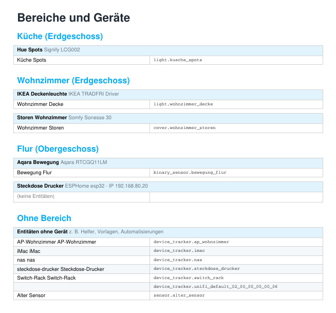
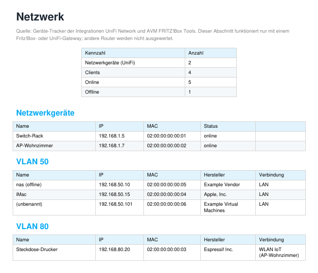
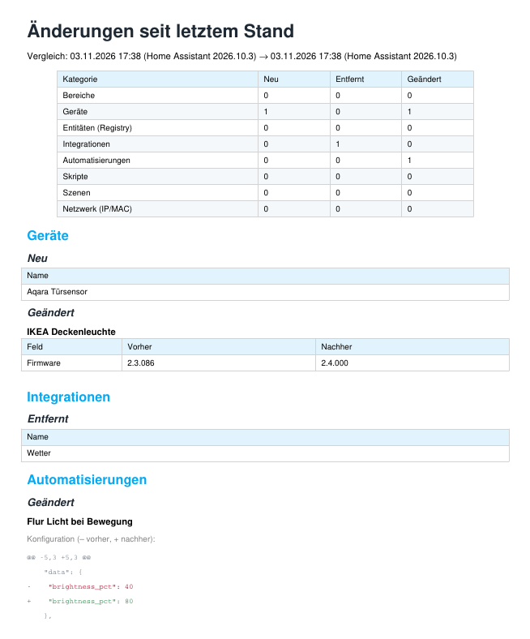
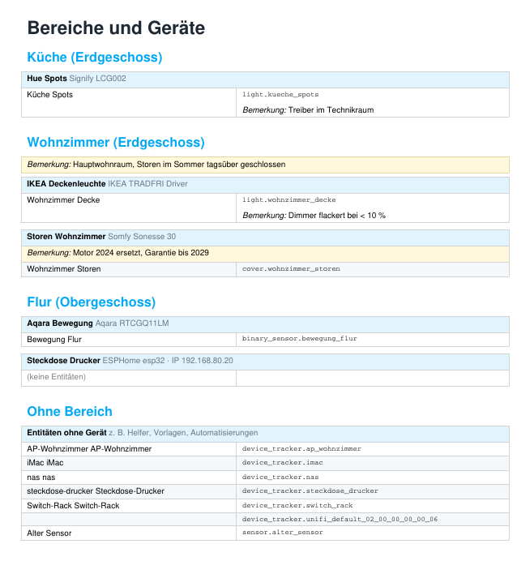

# 1. What is layvo Doku?

layvo Doku is a Home Assistant add-on. It reads your installation and creates a clear **PDF documentation** and, if you like, an **Excel file**. It runs locally, is read-only and does not change your configuration. It sends no data to the internet.

Depending on your selection, the PDF contains:

| Section | Content |
|---|---|
| Overview | Key figures (entities, devices, areas, integrations …) and entities by domain |
| Areas and devices | One box per device in each area with manufacturer, model, IP (if known) and all entities |
| Integrations | All configured integrations with status and source |
| Network | IP, MAC, vendor, VLAN and Wi-Fi/LAN of devices on your home network (UniFi or Fritz!Box only, see chapter 7) |
| Automations (text) | Triggers, conditions and actions in plain language; blueprint automations with their inputs |
| Automations (diagram) | Trigger → conditions → actions as a diagram |
| Scripts, scenes, helpers | Key details for each |
| Issues | Unavailable entities and references to entities that no longer exist |
| Your own notes | Optional, on areas, devices, entities and more (chapter 9) |
| Changes since last snapshot | Optional: comparison with the last saved snapshot (chapter 8) |

The section names in the add-on's web interface are shown in German.

# 2. Requirements

* Home Assistant OS or Supervised (add-ons must be available).
* Architecture amd64 or aarch64.
* For the "Network" section: the "UniFi Network" integration (UniFi gateway) or "AVM FRITZ!Box Tools" (Fritz!Box).

# 3. Installation

1. Open **Settings › Add-ons › Add-on Store › ⋮ › Repositories** and add this address:  
   `https://github.com/markus321/ha-doc-addon`
2. Install the add-on **layvo Doku**.
3. Enable **"Start on boot"** and **"Show in sidebar"**, then start the add-on.
4. Open **layvo Doku** in the sidebar.

Updates appear in the add-on store: **⋮ › Check for updates**, then **Update**. The check can take up to a minute; an "Unknown error" during that time is usually just a UI timeout. Reload the page after a minute.

# 4. Using the web interface

The interface follows Home Assistant's light/dark theme.

**Sections.** Tick what should go into the PDF. "Änderungen seit letztem Stand" (changes) is off by default.

**Options.**

* *Hide configuration and diagnostic entities* shortens the device list considerably. Each device then shows "+ n configuration/diagnostic entities hidden".
* *Automations, scripts, scenes: only with missing entities* lists only entries that reference entities that no longer exist. Handy for cleaning up.
* *Change comparison: save this state as the new reference* (only relevant with the changes section, chapter 8).

**Areas.** Under "Bereiche auswählen" you can limit the documentation to individual areas (including "Ohne Bereich", i.e. no area).

**Cover page.** Under **"Deckblatt: Ersteller und Kunde (optional)"** you can enter the company (creator) with address, phone, e-mail and website, the customer with address and object/project, and version/date and editor. With **"Angaben auf dem Deckblatt anzeigen"** (show details on the cover page) they appear on the cover of the PDFs, including the monthly report. It is off by default. The data is stored in `cover.json` in the `ha_doc` folder of the `share` folder. The PDF then contains names and addresses; you are responsible for sharing it and for data protection.

**Logo.** Under **"Logo im PDF"** (logo in the PDF) you choose whether the cover page and the footer of the PDFs show the **layvo logo**, **no logo** or your **own logo**. For your own logo select a PNG or JPG file (2 MB at most) and click **"Logo speichern"** (save logo). A landscape logo with a transparent background works best. The setting is stored in the `branding` folder of the `share` folder and survives a reinstall. It also applies to the monthly report but not to the Excel file.

**Buttons.**

| Button | Effect |
|---|---|
| PDF erstellen (create PDF) | Creates the PDF with the current selection |
| Excel erstellen (create Excel) | Creates the Excel file (chapter 6); areas and the diagnostic filter apply |
| Bemerkungen erfassen (add notes) | Opens the page for your own notes (chapter 9) |
| Auswahl für Monatsbericht speichern (save selection for monthly report) | Saves the current selection for the automatic report (chapter 5) |

**File list.** All created files are listed at the bottom. Click a name to open the PDF or download the Excel file. **Löschen** (delete, with confirmation) removes single files. The files are stored in the `share` folder under `ha_doc`, so you can also reach them via Samba or the file editor.

While you create a file yourself, the page refreshes automatically. For an automatic report, reload the page yourself.

# 5. Monthly report

Under the add-on's **Configuration**:

| Option | Meaning |
|---|---|
| Create a monthly report | Switches the automation on (default: off) |
| Day of month | 1 to 28 |
| Time | HH:MM, in your Home Assistant time zone |
| Number of PDFs to keep | How many **automatic** reports are kept (1 to 100) |
| Use the settings from the web interface | Default: on. The report uses the selection saved with "save selection for monthly report" |
| Section: … (switches) | Apply if nothing is saved or the web-interface setting is off |
| Hide diagnostic entities, Only entries with missing entities, Only these areas | Filters, also used as fallback |

**Important:**

* **Restart the add-on** after saving the configuration. It reads the configuration only at startup.
* The add-on must be running (**"Start on boot"**). If a run was missed, the add-on catches up at the next start.
* Below the file list you can see when the next report is created and what it contains.
* Automatic reports are named `ha_monatsbericht_…`, manually created files `ha_dokumentation_…`. Only automatic reports are cleaned up according to "Number of PDFs to keep". Manual files stay until you delete them.

# 6. Excel export

"Excel erstellen" creates an `.xlsx` file with three sheets:

* **Geräte (devices):** One row per area, below it the devices with manufacturer/model, IP and number of entities. The **entities are collapsed**. Use the **plus sign at the left edge** next to a device to expand them and the minus sign to collapse them again. The level buttons **1** and **2** at the top left collapse or expand everything at once. Each entity shows name, entity ID and current state.
* **Netzwerk (network):** IP, MAC, vendor, VLAN, connection and status with a filter (only with UniFi or Fritz!Box).
* **Integrationen (integrations):** Integration, domain, status, source.

The monthly report creates only the PDF, not an Excel file.

# 7. Network (UniFi and Fritz!Box only)

The "Network" section uses the device trackers of the **UniFi Network** and **AVM FRITZ!Box Tools** integrations. **It works only with a UniFi gateway or a Fritz!Box.** With other routers it stays empty, and the PDF says so.

* **Network devices** (gateway, switches, access points) are listed first with IP, MAC and status.
* **Clients** are grouped by VLAN with IP, MAC, vendor and connection (LAN, or Wi-Fi with SSID and access point).
* In the device table, a device shows its **IP** if its MAC address matches a tracker.

**Setting up UniFi:** Add the "UniFi Network" integration (host, local user, password; a Ubiquiti cloud account does not work). Under **Configure**, enable tracking of network clients. Without it, clients are missing.

Limits: the integration does not provide the switch port assignment. Clients without a hostname appear as "(unbenannt)" (unnamed) with MAC and vendor.

# 8. Change comparison (optional)

The section **"Änderungen seit letztem Stand (optional)"** is off by default. It adds the question: *what changed since last time?*

**How it works:**

* The add-on stores a **snapshot** (JSON) in the folder `ha_doc/snapshots` of the `share` folder. The last 24 are kept.
* The PDF compares the current state with the last snapshot: new, removed and changed areas, devices, entities (registry), integrations, automations, scripts, scenes and network addresses. For automations, scripts and scenes the configuration change is shown as before/after (red: removed, green: new).
* **Automatic reports** always save a new snapshot, so the monthly report compares with the previous month.
* **Manual reports** only compare. They change the reference only if you tick **"save this state as the new reference"**. This way test runs don't move the reference.
* The **first** run always saves a snapshot and shows "Erster gespeicherter Stand" (first saved state). Comparison starts with the next run.

**Limits:** The comparison shows **what** changed, not **who** changed it; Home Assistant usually does not record that. Between two snapshots it only sees the result, not every intermediate step. Labels and the areas of individual entities are not included yet. Your own notes (chapter 9) are compared as the category "Bemerkungen". This is a change log, not a tamper-proof audit trail: snapshots are protected neither against deletion nor modification.

# 9. Your own notes

With **"Bemerkungen erfassen"** (next to "Excel erstellen") you open a separate page where you can add your own text to your installation, for example "Motor replaced in 2024, warranty until 2029" or "Dimmer flickers".

**Using it:**

* The page is built like the Excel file: areas and devices are collapsed. Use the **plus sign** on the left to expand an area or a device. Inside there is a field for a note on the device and one field per entity.
* You can add notes to: **areas, devices, entities, integrations, network clients, automations, scripts and scenes**. There is also a **general note** that appears on the PDF cover page.
* The **search field** at the top filters by device, entity or name and expands the matches.
* A **●** after the name shows that a note already exists.
* **Speichern** (save) stores all fields. An empty field deletes the note.
* Configuration and diagnostic entities are hidden. The link at the top of the page shows them.

**Where the notes appear:**

* in the **PDF**, highlighted in yellow below the area, device, entity or entry (as a "Bemerkung" column for integrations and network),
* in the **Excel file** in the "Bemerkung" column (sheets Geräte, Netzwerk and Integrationen),
* in the **change comparison** (chapter 8) as a separate category "Bemerkungen".

Notes on automations, scripts and scenes appear in the PDF but not in the Excel file (it has no sheet for them).

**Storage:** The notes are stored in the file `notes.json` in the `ha_doc` folder of the `share` folder. They survive uninstalling the add-on and are easy to back up. Notes are tied to the IDs of the area, device and entity. If a device is deleted and re-created in Home Assistant it gets a new ID, and the note has to be entered again.

# 10. Troubleshooting

| Problem | Cause and solution |
|---|---|
| The monthly report was not created | Is the automation switched on? **Restart the add-on** after saving the configuration. The add-on must be running. The add-on log shows errors. |
| "Unknown error" when checking for updates | Usually a UI timeout while the store reloads. Wait a minute, reload the page, then update. |
| "No changelog found" on update | Harmless. The file `CHANGELOG.md` is missing from the add-on folder or named differently. |
| Network section empty | The UniFi or Fritz!Box integration is missing, or client tracking is off (chapter 7). |
| An automation appears with a note and no content | YAML automations **without an `id`** can't be read through the API. Add an `id:` in the YAML and they become readable. |
| Error message when creating the PDF | Copy the text shown under the button and report it as an issue (without personal data). |
| A file won't open | Reload the page. The add-on can only be reached through the Home Assistant sidebar (ingress). |

# 11. Privacy

The add-on reads the configuration through Home Assistant's internal interface (Supervisor) and writes files to `share/ha_doc`. It sends nothing to the internet. **The PDF contains names and IDs of your devices, IP and MAC addresses, automations, rooms and your own notes.** Share it with care and redact personal details before showing it publicly.

# 12. Known limitations

* YAML automations without an `id` can't be read (chapter 10).
* For a blueprint itself, triggers and actions are not shown, only its inputs.
* The "Network" section works only with a UniFi gateway or a Fritz!Box; switch port assignments are missing.
* Add-ons and Zigbee topology are not included (yet).
* Excel is created manually only, not in the monthly report.

# 13. License and support

MIT license, see `LICENSE`. The add-on is provided "as is". Please report bugs and wishes as an issue at `https://github.com/markus321/ha-doc-addon/issues`, without attaching files containing personal data.
